# Release History

Circle-to-Search Trigger의 모든 공개 릴리즈 기록입니다. 최신 버전이 위에 있습니다.
각 버전의 APK와 SHA-256 파일은 GitHub 릴리즈 페이지에서 받을 수 있습니다. (Beta) 표시는 프리릴리즈입니다.

| 버전 | 채널 | 날짜 |
| --- | --- | --- |
| [v0.4.1-patch3](https://github.com/JngVedere/OPD2515_CST/releases/tag/v0.4.1-patch3) | 베타 | 2026-11-26 |
| [v0.4.1-patch2](https://github.com/JngVedere/OPD2515_CST/releases/tag/v0.4.1-patch2) | 베타 | 2026-11-23 |
| [v0.4.1](https://github.com/JngVedere/OPD2515_CST/releases/tag/v0.4.1) | 정식 | 2026-11-22 |
| [v0.4.0](https://github.com/JngVedere/OPD2515_CST/releases/tag/v0.4.0) | 정식 | 2026-11-21 |
| [v0.3.9](https://github.com/JngVedere/OPD2515_CST/releases/tag/v0.3.9) | 정식 | 2026-11-19 |
| [v0.3.8](https://github.com/JngVedere/OPD2515_CST/releases/tag/v0.3.8) | 정식 | 2026-11-19 |
| [v0.3.7](https://github.com/JngVedere/OPD2515_CST/releases/tag/v0.3.7) | 정식 | 2026-11-18 |
| [v0.3.6](https://github.com/JngVedere/OPD2515_CST/releases/tag/v0.3.6) | 정식 | 2026-11-18 |
| [v0.3.5](https://github.com/JngVedere/OPD2515_CST/releases/tag/v0.3.5) | 베타 | 2026-11-17 |
| [v0.3.4](https://github.com/JngVedere/OPD2515_CST/releases/tag/v0.3.4) | 베타 | 2026-11-17 |
| [v0.3.3](https://github.com/JngVedere/OPD2515_CST/releases/tag/v0.3.3) | 베타 | 2026-11-17 |
| [v0.3.2-patch2](https://github.com/JngVedere/OPD2515_CST/releases/tag/v0.3.2-patch2) | 정식 | 2026-11-16 |
| [v0.3.2](https://github.com/JngVedere/OPD2515_CST/releases/tag/v0.3.2) | 정식 | 2026-11-16 |
| [v0.3.0](https://github.com/JngVedere/OPD2515_CST/releases/tag/v0.3.0) | 정식 | 2026-11-15 |
| [v0.2.6](https://github.com/JngVedere/OPD2515_CST/releases/tag/v0.2.6) | 정식 | 2026-11-15 |

---

## [v0.4.1-patch3 (Beta)](https://github.com/JngVedere/OPD2515_CST/releases/tag/v0.4.1-patch3) · 2026-11-26 · 베타

0.4.1-patch2에서 ColorOS가 부팅 중 OpdCTS의 접근성을 먼저 해제하면 자동 복구가 시작되지 않던 문제를 고쳤습니다.

#### 재부팅 후 자동 복구

- **접근성 목록에서 OpdCTS가 빠지면 부팅당 한 번 다시 등록합니다.** 부팅 후 접근성 상태를 확인하는 시간을 5초에서 30초로 늘렸습니다.
- 접근성 전체 스위치가 잠시 꺼져도 OpdCTS가 목록에 남아 있으면 복구 시도를 보류합니다.
- 자동 연결에 실패하면 알림을 눌러 시스템 접근성 설정을 열 수 있습니다.
- OPPO Pad Mini(OPD2515) 실기기에서 ColorOS 강제 해제 후 접근성 서비스가 다시 연결되는 것을 확인했습니다.

#### 편의성 개선

- **‘시스템 최적화 비활성화 항목 표시’**의 기본값을 끔으로 바꿨습니다. 이미 저장된 값은 유지됩니다.
- **‘전역 최대 주사율 설정’**의 자동 옵션은 **‘자동’**으로 간단히 표시합니다.

#### 업데이트 시 참고

- **재부팅 후 자동 복구**는 기본으로 켜져 있으며, 보안 설정 쓰기 권한이 필요합니다. 이전 버전에서 직접 켜거나 끈 설정은 업데이트 후에도 적용됩니다.
- 재부팅 후 기기 로그 승인 창이 뜨면 **‘일회성 액세스 허용’**을 눌러주세요.

---

## [v0.4.1-patch2 (Beta)](https://github.com/JngVedere/OPD2515_CST/releases/tag/v0.4.1-patch2) · 2026-11-23 · 베타

0.4.1에서 재부팅 뒤 동작하지 않던 문제와 기기 로그 승인 창 문제를 고친 베타입니다.

#### 기기 로그 승인 창
- **재부팅 후 승인 창이 더 빨리 뜹니다.** 첫 잠금 해제 뒤 약 30초를 기다리던 것을 줄였습니다.
- ColorOS 접근성 경고 창이 승인 창을 가려도 승인 창이 사라지지 않습니다.
- **승인 창을 늦게 눌러도 연결됩니다.** 창이 떠 있는 동안에는 최대 10분까지 기다립니다.
- **거부 직후에는 안내 후 자동으로 다시 묻습니다.**
  - Android는 거부 직후 약 1분 동안 승인 창을 띄우지 않습니다.
  - 그동안 남은 시간을 알려주고, 시간이 지나면 승인 창을 다시 띄웁니다.
- 승인 창을 띄운 직후 화면이 꺼지면 요청을 정리하고 다음 잠금 해제 때 다시 묻습니다.

#### Google 어시스턴트 연결
- **어시스턴트가 이미 Google인데도 '실행할 수 없음'이 뜨던 문제를 고쳤습니다.**
  - 음성 비서 연결이 어긋나 있으면 Google로 다시 맞춥니다. (보안 설정 쓰기 권한 필요)
  - 직접 다른 어시스턴트를 고른 경우에는 바꾸지 않습니다.

#### 재부팅 후 설정 유지
- **'시계에 초 표시' 등 편의 기능이 재부팅 후 꺼지던 문제를 고쳤습니다.**
  - ColorOS가 부팅마다 일부 값을 되돌려서, 앱이 켜 둔 값을 다시 적용합니다.
- **'재부팅 후 자동 복구'는 보안 설정 쓰기 권한이 있을 때만 켜짐으로 표시됩니다.**
  - 권한 없이는 동작하지 않는데도 켜진 것처럼 보였습니다.
  - 권한을 주면 자동으로 켜집니다.
- **알림 스위치도 실제로 알림을 받을 수 있을 때만 켜짐으로 표시됩니다.**
  - 시스템에서 알림을 끄면 꺼짐으로 보입니다.
  - '카메라 섬에도 표시'는 '기기 로그 권한이 없을 때 알림 받기'가 켜져 있어야 고를 수 있습니다.

#### 기타
- Gemini 요청 전 대기 기본값 15ms → 20ms (직접 바꾼 값은 그대로 유지)
- 최초 ADB 설정 안내의 '개발자 옵션 열기'를 누르면 '시스템 최적화 비활성화' 항목으로 바로 이동합니다.

---

## [v0.4.1](https://github.com/JngVedere/OPD2515_CST/releases/tag/v0.4.1) · 2026-11-22 · 정식

#### 새 디자인
- **화면 전체를 ColorOS 스타일로 다듬었습니다.** 연한 회색 바탕에 둥근 흰 카드, 큰 제목, 카드 위의 작은 회색 섹션 이름으로 바꿨고, 버튼도 그림자 없는 둥근 버튼이 됐습니다. 다크 모드도 함께 맞췄습니다.
- **하단 메뉴:** 화면 위에 떠 있는 둥근 메뉴로 바뀌었습니다. 선택된 탭은 눌려 들어간 듯한 홈으로 표시됩니다.
- **좌우로 밀어서 홈 ↔ 설정 이동:** 버튼이 아닌 곳을 좌우로 밀면 다른 탭으로 넘어갑니다. 넘어갈 때 페이지와 하단 메뉴가 함께 부드럽게 움직입니다.
- 기본 보기 방식이 **Compact(깔끔한 버전)** 가 됐습니다. 오른쪽 위 스위치로 바꿀 때 '깔끔한 버전 / 자세한 버전' 말풍선이 잠깐 뜹니다.
- 모든 설명과 안내 창의 문장을 줄바꿈이 어색하지 않게 다듬었습니다.

#### 새 기능 (설정 → 고급 → 편의 기능)
- **애니메이션 배율:** 개발자 옵션보다 세밀하게 0.01 단위로 조절합니다. 숫자를 누르면 0.00~10.00 사이로 직접 입력할 수 있고, 0.00은 애니메이션 없음입니다.
- **전역 최대 주사율 설정:** 자동 / 60 / 90 / 120 / 144Hz 중에서 고릅니다. **ADB 없이** 보안 설정 쓰기 권한만으로 바뀝니다. (144Hz는 게임 등 지원 앱에서만 144Hz로 동작합니다.)
- **시스템 최적화 비활성화 항목 표시:** 개발자 옵션의 'Disable system optimization'이 시스템 언어가 한국어여도 보이게 합니다. (기본으로 켜짐)
- **기기 및 앱 알림:** 알림 접근 권한 화면으로 바로 이동합니다.
- **편의 기능 타일 안내:** '편의 기능' 옆 **TIP**을 누르면 이 앱의 빠른 설정 타일(스위치 / 검색 / 어시스턴트 / 딥 다크 모드)을 아이콘과 함께 안내합니다.
- **모든 설정 초기화:** 고급 맨 아래에 있습니다. 앱 설정만 처음 상태로 되돌리며, ADB로 준 권한과 기기 로그 승인은 그대로 둡니다.

#### 새 기능 (빠른 설정 타일)
- **딥 다크 모드 타일:** 화면 더 어둡게(Extra Dim)를 바로 켜고 끕니다. 길게 누르면 '화면 더 어둡게' 설정이 열립니다.
- 타일 이름을 **스위치 / 검색 / 어시스턴트**로 바꿨습니다.

#### 새 기능 (실험적 기능)
- **접근성 없이 실행:** 접근성 대신 '다른 앱 위에 표시' 권한으로 동작합니다. 단점(최근 앱 정리 시 다시 켜지지 않음 등)은 설정에 적혀 있습니다.
- **호환성 개선 → 빠른 복구:** 게임 등으로 기기 로그 연결이 끊기면 승인 창을 바로 띄웁니다. (잠금이 풀린 화면에서만, 부팅마다 최대 5번)
- **호환성 개선 → 일부 앱에서 하단 영역 인식 강제 사용:** ColorOS 기본 하단 바 방식에서, 고른 앱(예: 게임)에서만 하단 터치 영역을 씁니다. 앱 목록은 별도 화면에서 검색하고 스위치로 고릅니다. 터치 영역이 떠 있는 동안에는 게임 모드가 앱을 멈추지 않아 기기 로그 연결도 유지됩니다.

#### 편의성 개선
- **시스템 UI 튜너가 ADB 없이 열립니다.** (ADB 필요 표시 제거)
- **시계에 초 표시:** 보안 설정 쓰기 권한이 없으면 시스템 UI 튜너에서 바꾸는 방법을 안내합니다.
- **개발자 옵션 빠른 접근:** 개발자 옵션이 꺼져 있으면 켠 뒤 바로 엽니다.
- **최근 앱 잠금 안내:** 최근 앱에서 이 앱이 잠겨 있지 않으면 경고하고, ColorOS '최근 작업 관리자' 화면을 열어 잠그도록 안내합니다.
- **자동 실행 설정:** 설정 검색에 '자동 실행'을 붙여넣을 수 있게 복사해 두고 검색 화면을 엽니다.
- **최초 ADB 설정 안내:** 명령마다 '복사' 버튼이 생겼고, 권한 설명은 접어 두었습니다. 개발자 옵션 열기 버튼도 추가했습니다.
- **ADB가 필요한 항목**(앱 설치 프로그램 광고 제거)의 명령을 상자에 담아 보기 쉽게 했습니다.
- 메뉴를 정리했습니다.
  - **재부팅 후 자동 복구**는 설정 → 고급 → 편의 기능 맨 위로 옮겼습니다. (기본으로 켜짐)
  - 홈의 '추가 설정'은 **추가 안내**로 이름을 바꿨습니다.
  - **터치 영역**은 **실행 방식** 카드 안(연결 앱 아래)으로 옮겼습니다. '터치 영역 설정'을 펼치면 인식 영역 표시가 자동으로 켜지고, 접으면 원래대로 돌아갑니다.
  - **고급**은 항상 펼쳐져 있고, 실험적 기능만 접혀 있습니다.
  - '화면 더 어둡게'는 시스템 화면으로 이동하는 항목으로, '앱 배터리 사용량'은 **앱 배터리 사용량 설정**으로 바꿨습니다.
  - '전역 고주사율'은 **전역 최대 주사율 설정**으로 바뀌었습니다.

#### 버그 수정
- ColorOS 기본 하단 바 방식에서 제스처 안내 막대가 켜져 있는데도 '오류'로 표시되던 문제를 고쳤습니다.
- 개발자 옵션을 끈 뒤 '개발자 옵션 빠른 접근'을 누르면 '켰습니다'만 뜨고 화면이 열리지 않던 문제를 고쳤습니다.
- 딥 다크 모드 타일을 길게 눌러 설정을 연 뒤 최근 앱에 빈 화면이 남던 문제와, 뒤로 가기를 누르면 앱이 닫히던 문제를 고쳤습니다.
- 하단 메뉴의 가장자리를 누르면 메뉴 뒤에 있는 버튼이 눌리던 문제를 고쳤습니다.

#### 업데이트 시 참고
- 보기 방식이 Compact로 바뀔 수 있습니다. 설명을 보려면 오른쪽 위 스위치를 Detail로 바꾸세요.
- 업데이트 후 기기 로그 승인을 다시 해야 할 수 있습니다.

---

## [v0.4.0](https://github.com/JngVedere/OPD2515_CST/releases/tag/v0.4.0) · 2026-11-21 · 정식

#### 새 기능
- **하단 바 추가:** 아래쪽에 **홈 / 설정** 탭이 생겼습니다. 업데이트, 알림, 고급은 **설정** 탭으로 옮겼습니다.
- **설정 → 고급 → 편의 기능** 추가 (고급은 기본으로 접혀 있습니다)
  - **화면 더 어둡게:** 켜고 끌 수 있고, '자세히 보기'를 누르면 시스템의 강도 조절 화면이 열립니다.
  - **자동 회전 제안 끄기:** 화면을 돌렸을 때 모서리에 뜨는 회전 버튼을 숨깁니다.
  - **시계에 초 표시**
  - **기기 이름 변경:** 네트워크 연결이나 온라인 인증 없이 기기 이름을 바꿉니다. 블루투스와 핫스팟 이름도 함께 바뀝니다.
  - **플래시 알림 / 앱 배터리 사용량 / 개발자 옵션:** 해당 시스템 화면으로 바로 이동합니다.
  - **시스템 UI 튜너 / 앱 설치 프로그램 광고 제거 / 전역 고주사율:** 앱 권한으로는 바꿀 수 없는 항목이라 'ADB 필요'로 표시됩니다. 누르면 필요한 ADB 명령과 되돌리는 방법이 나오고, 명령을 복사할 수 있습니다.
- **카메라 섬에 알림 표시:** 기기 로그 알림을 카메라 옆 캡슐(라이브 알림)에도 띄울 수 있습니다. **설정 → 알림 → 카메라 섬에도 표시**에서 켜고, '테스트'로 10초간 미리 볼 수 있습니다.
  - 이 앱의 알림 설정에서 '라이브 알림에 라이브 업데이트 표시'도 켜야 합니다.

#### 편의성 개선
- 기기 로그 연결이 끊겼을 때 알림이 더 빨리 옵니다(약 15초 뒤).
- 앱 아이콘을 누르면 기본으로 설정 화면이 열립니다. 서클 투 서치로 바꾸려면 **바로 실행 → 아이콘을 누르면**에서 선택하세요.
- 길게 누르기 인식 시간 기본값을 275ms에서 195ms로 줄였습니다.
- 터치 영역의 위치·크기는 **터치 영역 설정** 안으로 접어 넣었습니다. 길게 누르기 인식 시간과 '기본값으로 되돌리기'도 이 안에 있습니다.
- **연결 앱**을 **실행 방식** 아래로 옮겼습니다.
- '기본 어시스턴트 설정'을 누르면 Google을 선택하라는 안내가 함께 뜹니다.
- 기기 로그 상태 표시를 바꿨습니다.
  - 승인이 필요하면 빨간색으로 표시합니다.
  - 거부했다면 '승인 거부됨 (이번 부팅 n회)'과 자동 요청 안내(60초마다, 최대 3회)를 보여줍니다.
- 설정 아래쪽에 따로 있던 '기기 로그 접근 승인 요청' 섹션을 없앴습니다. 승인은 화면 위쪽 안내를 누르면 됩니다.
- 일부 항목 옆에 (i) 표시를 추가했습니다. 누르면 설명이 말풍선으로 뜹니다.

#### 버그 수정
- 재부팅 직후 기기 로그 확인 창에서 '허용 안 함'이나 창 바깥을 누르면 태블릿이 한동안 멈춘 것처럼 보이던 문제를 고쳤습니다. ColorOS 접근성 안내 창이 확인 창을 가린 것이 원인이었고, 이제 그 안내 창이 지나간 뒤에 확인 창을 띄웁니다.
- 확인 창을 거부한 뒤 앱이 다시 시작되면(업데이트, ColorOS의 앱 정리 등) 자동 재요청이 멈추던 문제를 고쳤습니다.

#### 업데이트 시 참고
- 화면 더 어둡게, 회전 제안, 시계 초 스위치는 Android 12부터 앱이 시스템 값을 읽을 수 없어서, 이 앱에서 마지막으로 바꾼 상태를 보여줍니다. 시스템 설정에서 따로 바꿨다면 스위치 표시가 실제와 다를 수 있습니다.
- 업데이트 후 기기 로그 승인을 다시 해야 할 수 있습니다.
- 업데이트하면 ColorOS가 '백그라운드 활동 허용'을 초기화할 수 있습니다. 설정 화면 맨 위에 경고가 뜨면 눌러서 다시 허용해주세요.

---

## [v0.3.9](https://github.com/JngVedere/OPD2515_CST/releases/tag/v0.3.9) · 2026-11-19 · 정식

#### 편의성 개선
- 잠금을 해제하면 기기 로그 확인 창이 바로 뜹니다.
  - 화면이 꺼져 있거나 잠긴 동안 기기 로그 연결이 끊긴 경우(재부팅, 업데이트 등), 이전에는 설정 화면을 직접 열어야 했습니다.
  - 재부팅 직후 USB 연결 창이나 ColorOS 접근성 안내 창에 가려 확인 창이 넘어가 버린 경우에도, 다음 잠금 해제 때 다시 뜹니다. 정말로 거부했다면 한 번 부팅에 최대 3번까지만 묻습니다.
- 기기 로그 알림을 누르면 설정 화면 대신 기기 로그 확인 창이 바로 뜹니다. ADB 권한 자체가 없을 때는 설정 화면이 열립니다.
- 확인 창을 거부한 뒤 오는 알림은 30초 늦게 옵니다. 거부 직후 약 1분 동안은 Android가 새 요청을 자동으로 거부하기 때문에, 바로 눌러도 확인 창이 뜨도록 했습니다.
- 접근성이 꺼져 있을 때 설정 화면 위쪽에 '앱의 액세스가 거부됨'(제한된 설정) 해결 방법을 함께 보여줍니다. 누르면 앱 정보가 열리고, 오른쪽 위 ⋮ → '제한된 설정 허용'으로 풀 수 있습니다.
- 최근 앱 정리 안내에서 '기기 로그를 다시 승인해야 합니다'는 기기 로그가 필요한 옵션(ColorOS 기본 바, 전원 버튼)이 켜져 있을 때만 표시합니다.

#### 업데이트 시 참고
- 업데이트 후 기기 로그 승인을 다시 해야 할 수 있습니다.
- 업데이트하면 ColorOS가 '백그라운드 활동 허용'을 초기화할 수 있습니다. 설정 화면 맨 위에 경고가 뜨면 눌러서 다시 허용해주세요.

---

## [v0.3.8](https://github.com/JngVedere/OPD2515_CST/releases/tag/v0.3.8) · 2026-11-19 · 정식

#### 새로운 기능
- 알림 설정 (설정 → 알림, 두 항목 모두 기본값 꺼짐)
  - **기기 로그 권한이 없을 때 알림 받기:** ColorOS 기본 바나 전원 버튼처럼 기기 로그가 필요한 옵션이 켜져 있는데 다음과 같을 때 알려줍니다. 알림을 누르면 설정 화면이 열리고, 기기 로그가 다시 연결되면 알림은 자동으로 사라집니다.
    - 기기 로그 권한(ADB)이 없을 때
    - 1분이 지나도 기기 로그가 승인되지 않았을 때 (예: 잠긴 상태에서 업데이트되어 확인 창이 뜨지 못한 경우)
    - 승인이 거부되었을 때
    - 승인된 연결이 끊겼을 때
  - **새로운 업데이트가 있을 때 알림 받기:** 24시간에 한 번만 GitHub에서 새 버전을 확인하고, 같은 버전은 한 번만 알려줍니다. 알림을 누르면 설정 화면 위쪽에 업데이트 안내가 뜹니다. '베타 버전도 확인' 설정을 따릅니다.
  - 켤 때 알림 권한이 없으면 권한을 요청합니다. 거부하면 두 항목 모두 다시 꺼집니다.

#### 업데이트 시 참고
- 알림 기능 때문에 알림 권한이 추가되어, 설치 화면에 '민감한 권한 1개'가 표시될 수 있습니다. 알림은 설정에서 직접 켜기 전에는 요청하지도, 보내지도 않습니다.
- 업데이트 후 기기 로그 승인을 다시 해야 할 수 있습니다.
- 업데이트하면 ColorOS가 '백그라운드 활동 허용'을 초기화할 수 있습니다. 설정 화면 맨 위에 경고가 뜨면 눌러서 다시 허용해주세요.
- 접근성을 켤 때 '제한된 설정'으로 막히면 README의 [자주 묻는 질문 Q7](https://github.com/JngVedere/OPD2515_CST#자주-묻는-질문)을 참고해주세요.

---

## [v0.3.7](https://github.com/JngVedere/OPD2515_CST/releases/tag/v0.3.7) · 2026-11-18 · 정식

#### 오류 수정
- 앱 아이콘을 눌러 서클 투 서치를 열 때 빈 화면이 잠깐 보이던 문제를 수정했습니다. 홈 화면과 앱 서랍 모두에서 고쳐졌습니다.

#### 편의성 개선
- 앱 아이콘을 눌렀을 때 열 화면을 고를 수 있습니다 (설정 → 바로 실행 → 아이콘을 누르면).
  - 서클 투 서치 (기본값) / Gemini Assistant / 설정 화면
  - Gemini Assistant는 전원 버튼 기능이 꺼져 있어도 열립니다.
- 길게 누르기 인식 시간을 최소 50ms까지 줄일 수 있습니다 (기존 200ms). 200ms 미만에서는 짧은 탭이나 홈 스와이프 시작도 길게 누르기로 인식될 수 있습니다.

#### 업데이트 시 참고
- 업데이트 후 기기 로그 승인을 다시 해야 할 수 있습니다.
- 업데이트하면 ColorOS가 '백그라운드 활동 허용'을 초기화할 수 있습니다. 설정 화면 맨 위에 경고가 뜨면 눌러서 다시 허용해주세요.

---

## [v0.3.6](https://github.com/JngVedere/OPD2515_CST/releases/tag/v0.3.6) · 2026-11-18 · 정식

0.3.2-patch2 이후 첫 정식 버전입니다. 베타로 먼저 나왔던 0.3.3~0.3.5의 변경 사항이 모두 포함되어 있습니다.

#### 새로운 기능
- MiCTS 없이 서클 투 서치를 직접 실행합니다. 이제 MiCTS 설치가 필요 없습니다.
  - 하단 바 길게 누르기 후 서클 투 서치가 뜨기까지 더 빨라졌습니다 (약 0.1초 → 0.03~0.06초).
  - MiCTS가 설치되어 있으면 직접 실행이 실패했을 때만 예비로 씁니다.
- 앱 서랍 아이콘 (OpdCTS)
  - 누르면 연결 앱 설정과 상관없이 서클 투 서치가 열리고, 길게 눌러 '설정'을 고르면 설정 화면이 열립니다.
  - 설치하면 앱 서랍에 바로 보입니다. 원하지 않으면 설정 → 바로 실행 → '앱 서랍에 표시'로 끌 수 있습니다.
- 빠른 설정 타일 2개
  - Search: 서클 투 서치를 엽니다. 잠겨 있으면 잠금 해제 후 열립니다.
  - Assistant: Gemini Assistant를 엽니다. 전원 버튼 기능이 꺼져 있어도 동작합니다.
- 3버튼 탐색 모드에서 홈 버튼을 길게 눌러 연결 앱 실행 (ColorOS 기본 하단 바 방식)
- 하단 영역 위치·크기, 길게 누르기 인식 시간, Gemini 요청 전 대기 시간 조절
  - 가로/세로 화면 값을 따로 저장하고, 값을 눌러 숫자로 직접 입력할 수 있습니다.
- 앱 안에서 업데이트 확인과 설치, 설정을 열 때 자동 확인과 상단 알림
- 전원 버튼 두 번 눌러 앱 실행 (설정 → 고급 → 실험적 기능, 기본값 꺼짐)
- 앱 아이콘 추가

#### 편의성 개선
- 설정 화면 오른쪽 위의 Detail / Compact 전환 (Compact는 항목 아래 부가 설명을 숨깁니다)
- 상태 카드 정리, 권한·자동 실행·백그라운드 제한 경고 표시
- 최근 앱 "모두 닫기" 후 Gemini 예열이 더 빨리 끝납니다.
- 최근 실행 기록에 전원 버튼을 누른 뒤 Gemini 요청까지 걸린 시간을 표시합니다.
- 배터리 사용 감소: 관계없는 앱 종료 로그로는 앱이 깨어나지 않습니다.
- 다크 모드 표시 개선

#### 기본값 변경
- 길게 누르기 인식 시간 350ms → 275ms, Gemini 요청 전 대기 30ms → 15ms
- 하단 영역 너비: 제스처 바와 작업 표시줄이 함께 켜져 있으면 세로 240dp · 가로 330dp, 아니면 200dp

#### 업데이트 시 참고
- 업데이트 후 기기 로그 승인을 다시 해야 할 수 있습니다.
- 업데이트하면 ColorOS가 '백그라운드 활동 허용'을 초기화할 수 있습니다. 설정 화면 맨 위에 경고가 뜨면 눌러서 다시 허용해주세요.
- 이 버전부터 앱 안의 '업데이트 확인'으로 다음 버전을 바로 설치할 수 있습니다.

#### 라이선스
- 이 버전부터 GNU GPL-3.0으로 배포합니다. 설정 화면 맨 아래 '오픈소스 라이선스'에서 고지를 볼 수 있습니다.

#### 스크린샷
| | |
| --- | --- |
| **앱 서랍 아이콘 (OpdCTS)** 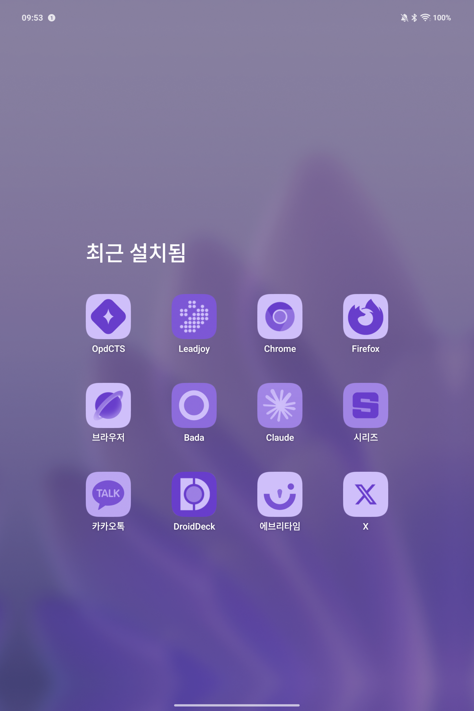 | **아이콘 길게 누르기 → 설정** 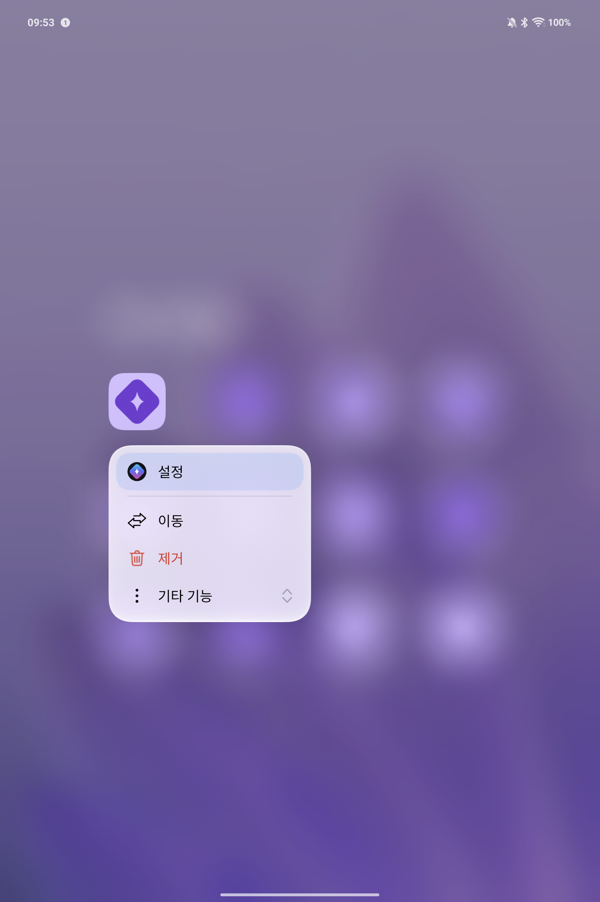 |
| **아이콘 탭 → 서클 투 서치** 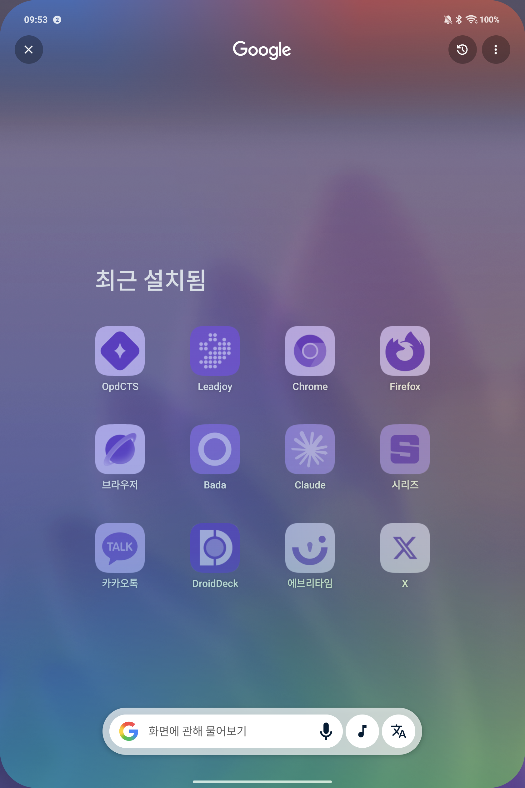 | **빠른 설정 타일 Search / Assistant** 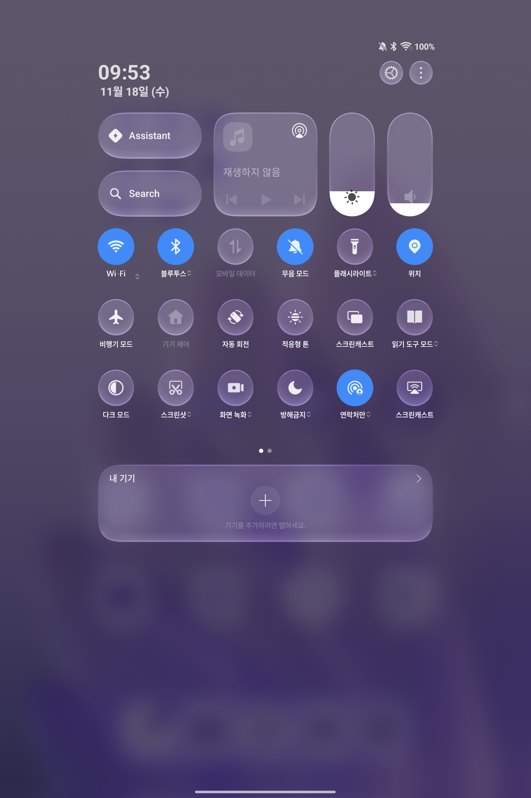 |
| **Assistant 타일 → Gemini Assistant** 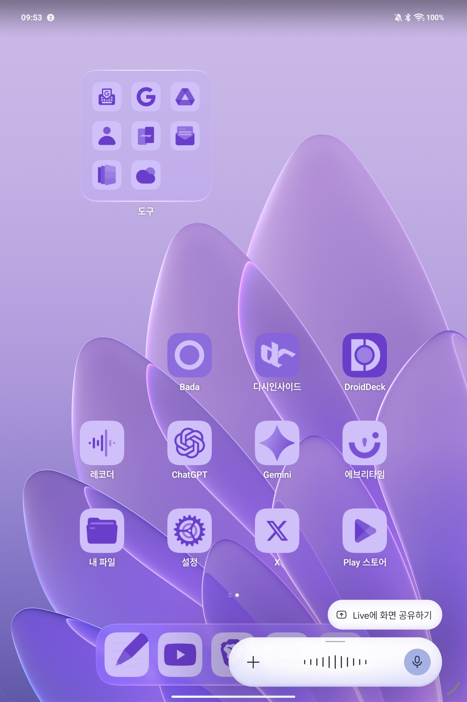 | **3버튼 홈 버튼 길게 누르기 → 서클 투 서치** 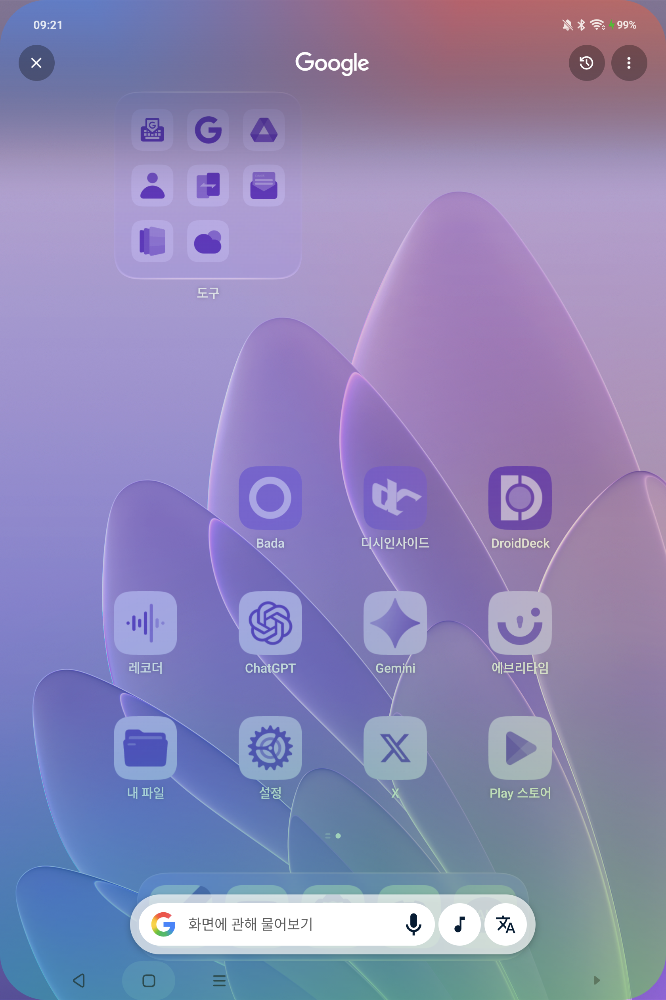 |
| **Detail / Compact 전환** 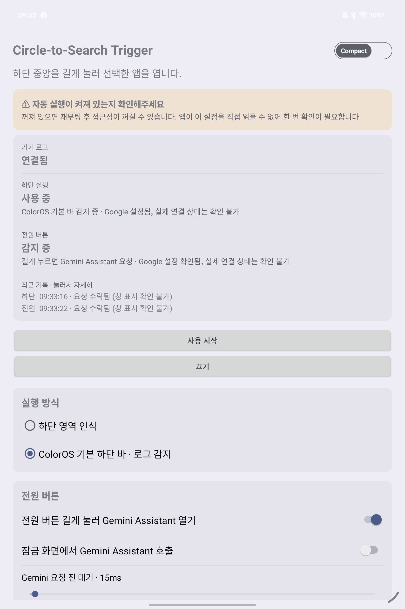 | **바로 실행 설정** 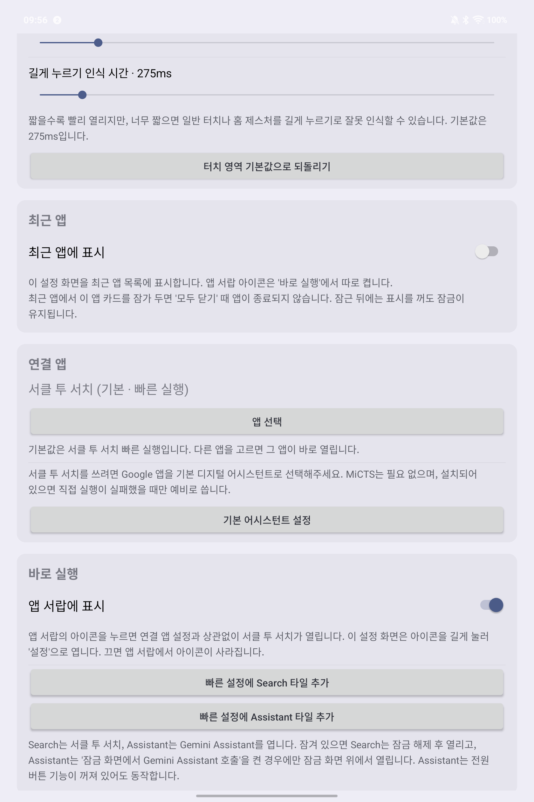 |
| **터치 영역 위치·크기와 화면 방향 표시** 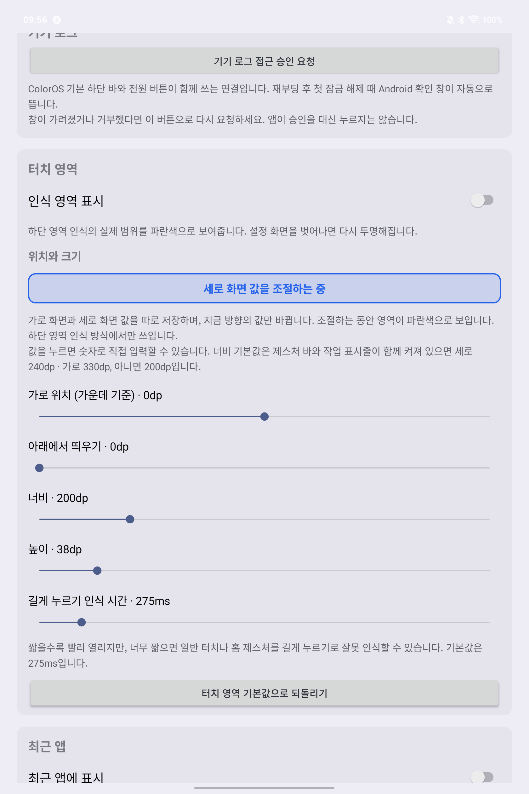 | **값을 눌러 숫자로 입력** 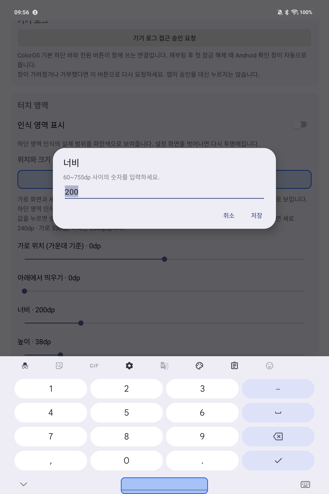 |
| **Gemini 요청 전 대기** 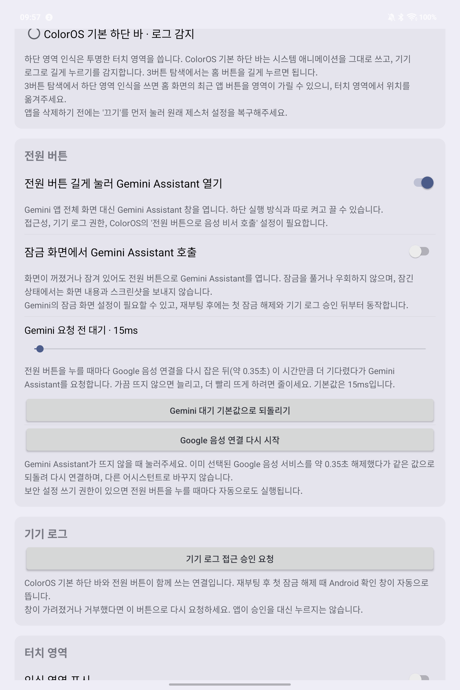 | **앱 안에서 업데이트** 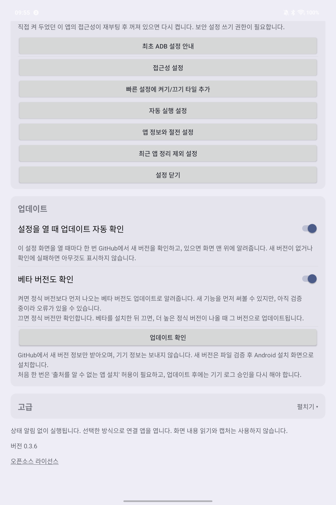 |
| **실험적 기능: 전원 버튼 두 번 누르기** 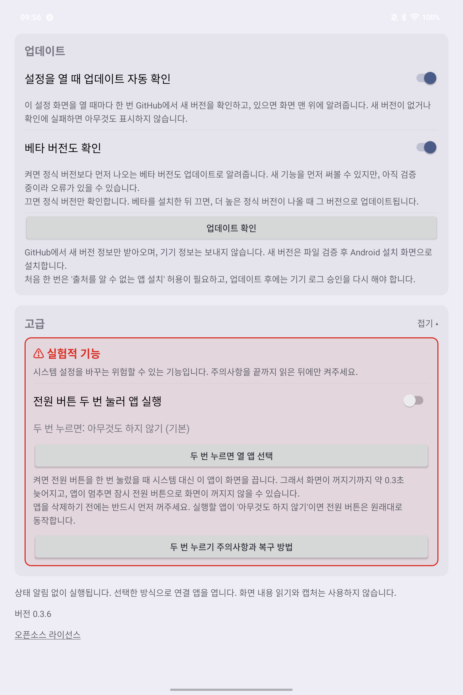 | **오픈소스 라이선스** 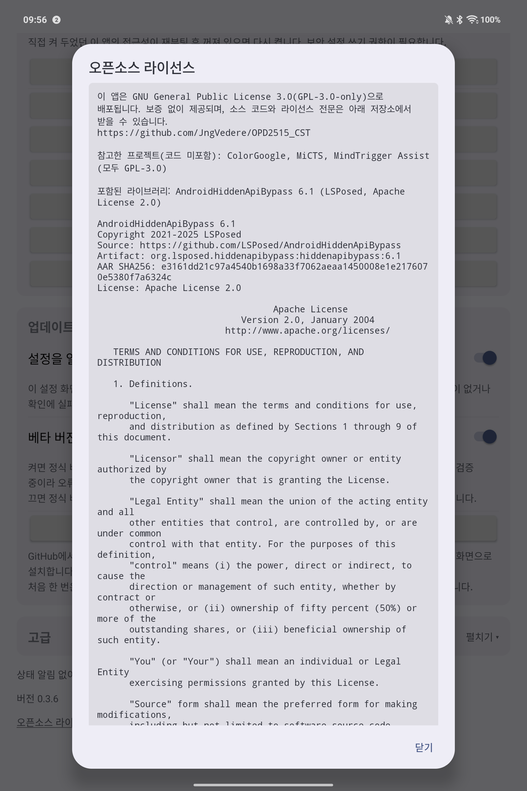 |

---

## [v0.3.5 (Beta)](https://github.com/JngVedere/OPD2515_CST/releases/tag/v0.3.5) · 2026-11-17 · 베타

#### 새로운 기능
- 하단 영역 위치·크기 조절
  - 조절 항목: 가로 위치, 하단에서 띄우는 거리, 너비, 높이
  - 가로 화면과 세로 화면 값을 따로 저장합니다.
  - 조절하는 동안 영역이 파란색으로 보입니다.
- 길게 누르기 인식 시간 조절 (200~1000ms)
- Gemini 요청 전 대기 시간 조절 (0~1000ms)
- 값을 눌러 숫자로 직접 입력 (허용 범위 밖의 값은 저장되지 않음)
- 섹션별 기본값 되돌리기

#### 기본값 변경
- 길게 누르기 인식 시간 350ms → 275ms
- Gemini 요청 전 대기 30ms → 15ms
- 하단 영역 너비: 제스처 바와 작업 표시줄이 함께 켜져 있으면 세로 240dp · 가로 330dp, 아니면 200dp
- 직접 바꾼 값은 기본값이 바뀌어도 그대로 유지됩니다.

#### 편의성 개선
- 터치 영역 설정에 지금 조절 중인 화면 방향(가로/세로)을 표시합니다. ColorOS 기본 하단 바 방식에서는 회색으로 표시됩니다.
- 작업 표시줄이나 탐색 방식을 바꾸면 하단 영역 너비 기본값이 바로 반영됩니다.
- 최근 앱 "모두 닫기" 후 Gemini 예열이 더 빨리 끝납니다 (약 0.87초 → 0.53초).
- 3버튼 탐색 모드에서 하단 영역을 옮겨 최근 앱 버튼을 피할 수 있습니다.
- 배터리 사용 감소: 관계없는 앱 종료 로그로는 앱이 깨어나지 않고, 접근성 설정은 값이 바뀔 때만 다시 적용합니다.

#### 오류 수정
- 최근 앱 "모두 닫기"를 연달아 하는 등 Google이 짧은 시간 안에 다시 종료되면 예열을 건너뛰어 Gemini Assistant가 뜨지 않을 수 있던 문제

---

## [v0.3.4 (Beta)](https://github.com/JngVedere/OPD2515_CST/releases/tag/v0.3.4) · 2026-11-17 · 베타

#### 새로운 기능
- 전원 버튼 두 번 눌러 앱 실행 (설정 → 고급 → 실험적 기능, 기본값 꺼짐, 앱 삭제 전 끄기 필요)
- 3버튼 탐색 모드에서 홈 버튼 길게 눌러 연결 앱 실행 (ColorOS 기본 하단 바 · 로그 감지 방식)
- 설정을 열 때 업데이트 자동 확인과 상단 알림

#### 편의성 개선
- 상태 카드 순서 변경과 사용하지 않는 기능의 표시 생략
- 고급 항목 펼치기·접기
- 실험적 기능의 위험성 안내와 adb 복구 명령 복사

#### 오류 수정
- 3버튼 탐색 모드에서 제스처 안내 막대 오류가 잘못 표시될 수 있던 문제

---

## [v0.3.3 (Beta)](https://github.com/JngVedere/OPD2515_CST/releases/tag/v0.3.3) · 2026-11-17 · 베타

### Circle-to-Search Trigger 0.3.3 (Beta)

0.3.2-patch2 이후 변경 사항

#### 새로운 기능

- 앱 내 업데이트 확인 (새 버전 확인·파일 검증 후 설치, 베타 버전 확인 옵션)
- 설정 화면 상단 주의 안내 (접근성, 권한, 기기 로그, 백그라운드 활동, 자동 실행, 최근 앱 정리)

#### 편의성 개선

- 재부팅 후 자동 복구 기본값 켬
- 설정 버튼이 안내한 화면으로 정확히 이동
- 설정 화면 문구 정리 및 줄바꿈 개선
- '작은 Gemini' 명칭을 Gemini Assistant로 통일
- 최근 앱 정리 제외·최초 ADB 설정 안내 보강

#### 오류 수정

- 재부팅 후 기기 로그 승인 요청 중 화면이 터치에 반응하지 않던 문제
- 재부팅 후 기기 로그 승인 요청이 다른 창에 의해 열리지 않던 문제 추가 수정 
- 권한 부여 후 접근성이 멈춘 상태를 알 수 없던 문제

---

## [v0.3.2-patch2](https://github.com/JngVedere/OPD2515_CST/releases/tag/v0.3.2-patch2) · 2026-11-16 · 정식

### Circle-to-Search Trigger 0.3.2

0.3.0 이후 변경 사항

#### 새로운 기능

- 잠금 화면 Gemini 호출 옵션 추가 (전원 버튼 → 화면이 꺼지거나 잠긴 상태에서 Assistant 호출, 기본값 꺼짐)
  - 잠금 해제·우회 없음
  - 잠긴 상태에서 화면 내용·스크린샷 전송 없음
  - 재부팅 후 첫 잠금 해제와 기기 로그 승인 전에는 미동작
- 최근 실행 기록 추가 (하단 실행·전원 버튼별 마지막 시도 결과, 시각·입력·결과·실패 사유 확인 가능 기기 내 저장만 하고 외부 전송 없음)
- 앱 업데이트 시 ADB 및 권한 유지

#### 편의성 개선

- 설정 화면 UI 개편 (상단 상태 카드에 하단 실행·기기 로그·전원 버튼 상태 표시, 섹션별 카드 구성)
- 상태 안내 세분화 (접근성 승인, 보안 설정 쓰기 권한, Breeno 비활성화, 기기 로그 권한·승인 대기, 기본 어시스턴트 Google 선택 여부, Google 음성 서비스 사용 가능 여부)
- 연결 앱 설정 오류나 MiCTS·선택한 앱 실행 실패 시 최근 실행 기록에 실패 사유 기록
- 하단 길게 누르기 인식 시간 개선
- 서클 투 서치 반응성 개선
- Gemini Assistant 반응성 개선
- 앱 안정성 개선

#### 오류 수정

- 장시간 미사용 후 Google 음성 서비스 연결이 끊겨 전원 버튼 Gemini가 뜨지 않던 문제
- 재연결 중 화면 꺼짐·옵션 변경·기기 로그 연결 변경 시 남은 Gemini를 요청하던 문제
- 전원 버튼 연타 시 중복으로 Gemini Assistant가 호출되던 문제
- Circle to Search에서 '화면에 관해 물어보기'가 비정상적으로 오래 걸리던 문제 일부 해결
- 설정 -> 앱에서 작업 표시줄 표시 가 켜져있는 경우 ColorOS 기본 하단 바를 통한 Circle to Search가 동작하지 않던 문제
- 재부팅 후 '기기 로그 수집 일회성 액세스 허용'이 다른 창에 의해 가려질 수 있던 문제
- 재부팅 후 '기기 로그 수집 일회성 액세스 허용'이 비정상적으로 오랫동안 뜨지 않던 문제
- patch2 - 최근 앱 닫기 후 최초 gemini assistant가 안 켜지던 문제 해결

#### 알려진 이슈

- CIrcle to Search에서 Scroll Translate 사용 불가능
- 재부팅 후 '기기 로그 수집 일회성 액세스 허용' 단계에서 앱이 비정상적으로 멈출 수 있음

---

## [v0.3.2](https://github.com/JngVedere/OPD2515_CST/releases/tag/v0.3.2) · 2026-11-16 · 정식

### Circle-to-Search Trigger 0.3.2

0.3.0 이후 변경 사항

#### 새로운 기능

- 잠금 화면 Gemini 호출 옵션 추가 (전원 버튼 → 화면이 꺼지거나 잠긴 상태에서 Assistant 호출, 기본값 꺼짐)
  - 잠금 해제·우회 없음
  - 잠긴 상태에서 화면 내용·스크린샷 전송 없음
  - 재부팅 후 첫 잠금 해제와 기기 로그 승인 전에는 미동작
- 최근 실행 기록 추가 (하단 실행·전원 버튼별 마지막 시도 결과, 시각·입력·결과·실패 사유 확인 가능 기기 내 저장만 하고 외부 전송 없음)
- 앱 업데이트 시 ADB 및 권한 유지

#### 편의성 개선

- 설정 화면 UI 개편 (상단 상태 카드에 하단 실행·기기 로그·전원 버튼 상태 표시, 섹션별 카드 구성)
- 상태 안내 세분화 (접근성 승인, 보안 설정 쓰기 권한, Breeno 비활성화, 기기 로그 권한·승인 대기, 기본 어시스턴트 Google 선택 여부, Google 음성 서비스 사용 가능 여부)
- 연결 앱 설정 오류나 MiCTS·선택한 앱 실행 실패 시 최근 실행 기록에 실패 사유 기록
- 하단 길게 누르기 인식 시간 개선
- 서클 투 서치 반응성 개선
- Gemini Assistant 반응성 개선
- 앱 안정성 개선

#### 오류 수정

- 장시간 미사용 후 Google 음성 서비스 연결이 끊겨 전원 버튼 Gemini가 뜨지 않던 문제
- 재연결 중 화면 꺼짐·옵션 변경·기기 로그 연결 변경 시 남은 Gemini를 요청하던 문제
- 전원 버튼 연타 시 중복으로 Gemini Assistant가 호출되던 문제
- Circle to Search에서 '화면에 관해 물어보기'가 비정상적으로 오래 걸리던 문제 일부 해결
- 설정 -> 앱에서 작업 표시줄 표시 가 켜져있는 경우 ColorOS 기본 하단 바를 통한 Circle to Search가 동작하지 않던 문제
- 재부팅 후 '기기 로그 수집 일회성 액세스 허용'이 다른 창에 의해 가려질 수 있던 문제
- 재부팅 후 '기기 로그 수집 일회성 액세스 허용'이 비정상적으로 오랫동안 뜨지 않던 문제

#### 알려진 이슈

- CIrcle to Search에서 Scroll Translate 사용 불가능
- 재부팅 후 '기기 로그 수집 일회성 액세스 허용' 단계에서 앱이 비정상적으로 멈출 수 있음

---

## [v0.3.0](https://github.com/JngVedere/OPD2515_CST/releases/tag/v0.3.0) · 2026-11-15 · 정식

v0.2.6 대비 전원 버튼 Gemini 호출 기능을 추가하고, ColorOS 기본 하단 바의 실행 구조와 재부팅 후 복구 방식을 변경했습니다. 

### 주요 변경 사항

#### 전원 버튼으로 Gemini 호출

- 전원 버튼을 길게 누르면 작은 Gemini 어시스턴트 팝업이 열립니다.
- Gemini 앱 전체 화면 대신 Google 어시스턴트 세션을 요청합니다.
- 하단 Circle to Search 기능과 별도로 켜고 끌 수 있습니다.
- ColorOS의 전원 버튼 음성 비서 호출 설정이 필요합니다.
- 잠금 화면에서는 동작하지 않습니다.

#### ColorOS 기본 하단 바 실행 방식 변경

- 별도 ADB 셸 에이전트 대신 앱 내부의 기기 로그 연결로 입력을 감지합니다.
- 최초 ADB 권한 설정 이후에는 재부팅마다 활성화 명령을 다시 실행할 필요가 없습니다.
- 재부팅 후 첫 잠금 해제에서 기기 로그 접근을 한 번 허용하면, 기본 하단 바와 전원 버튼 Gemini 기능을 다시 사용할 수 있습니다.
- 기존 접근성 자동 복구 기능과 함께 사용할 수 있습니다.

#### Google 음성 서비스 연결 복구

Google이 기본 어시스턴트로 선택되어 있어도 내부 음성 서비스 연결이 끊기면 Gemini 팝업이 열리지 않을 수 있습니다.

- 설정에 **Google 음성 연결 다시 시작** 버튼을 추가했습니다.
- **사용 시작** 또는 전원 버튼 Gemini 기능을 켤 때, 필요한 조건을 확인하고 기존 Google 음성 서비스를 한 번 재연결합니다.
- 전원 버튼을 누를 때마다 재연결하지는 않습니다.

#### 앱 이름 변경

앱 이름을 **하단 검색(Bottom Search)**에서 **Circle-to-Search Trigger**로 변경하고, 앱 설정과 사용 가이드의 명칭을 통일했습니다.

### 버그 수정

#### Gemini 및 연결 복구

- 전원 입력을 감지하고 실행 요청도 수락했지만 실제 Gemini 팝업이 나타나지 않던 문제를 수정했습니다.
- 진단 로그에서 요청 수락과 실제 팝업 표시가 다른 결과임을 명시했습니다.
- 음성 서비스 재연결 중 앱 종료, 권한 회수 및 오류가 발생하는 경우의 복구 처리를 보강했습니다.
- 복구 중 사용자가 다른 어시스턴트를 선택하면 해당 선택을 덮어쓰지 않도록 했습니다.
- 재연결 요청이 중복 실행되지 않도록 했습니다.

#### 설정 및 로그 처리

- 설정 화면의 상태 갱신이 사용자 입력으로 처리되어 불필요한 재연결을 실행하던 문제를 수정했습니다.
- 전원 버튼과 자동 복구 설정의 상태 반영을 개선했습니다.
- 오래되거나 중복된 로그 이벤트가 기능을 실행하지 않도록 검증을 강화했습니다.
- 로그 연결 종료 처리와 연결 상태 표시를 개선했습니다.
- 복구 및 로그 감지 관련 회귀 검사를 추가했습니다.

### 기존 기능

다음 기능은 계속 사용할 수 있습니다.

- 하단 중앙 길게 누르기로 Circle to Search 실행
- 하단 영역 인식 또는 ColorOS 기본 하단 바 방식 선택
- 하단 인식 범위 미리 보기
- Circle to Search 대신 원하는 앱 연결
- 빠른 설정 타일을 통한 기능 제어
- 최근 앱 목록 표시 여부 설정
- 접근성 자동 복구
- 루팅 및 부트로더 잠금 해제 없이 사용

### 설치 및 업데이트

**설치 파일:** `Circle-to-Search-Trigger-0.3.0.apk`

기존 앱 위에 설치하면 업데이트할 수 있습니다. 패키지명과 서명이 동일하므로 기존 설정이 유지됩니다.

v0.2.6에서 업데이트한 경우, 새 기능에 필요한 권한은 앱의 **최초 ADB 설정 안내**를 확인해 추가로 허용해주세요.

`.sha256` 파일은 다운로드한 APK의 무결성 확인용이며, 설치에 필수는 아닙니다.

#### 전원 버튼 Gemini 사용 조건

- 기본 디지털 어시스턴트: **Google**
- Google의 모바일 어시스턴트: **Gemini**
- ColorOS 전원 버튼 길게 누르기: **음성 비서 호출**
- 최초 ADB 설정 안내에 따른 권한 허용

ColorOS 기본 하단 바 방식은 Breeno 비활성화가 필요합니다. Google 음성 연결 복구에는 **보안 설정 쓰기 권한**이 필요합니다.

### 알려진 제한 사항

- **테스트 환경:** OPPO Pad Mini OPD2515 / ColorOS 17 중국 내수롬 / Android 17
- OPD2515에서 완전 삭제 후 재설치를 포함한 동작을 확인했습니다. 다른 기기의 동작은 보장하지 않습니다.
- 최초 권한 설정에는 ADB가 필요합니다. **Shizuku 연동은 포함되어 있지 않습니다.**
- 재부팅 후 기본 하단 바와 전원 버튼 기능을 사용하려면 기기 로그 접근을 다시 허용해야 합니다.
- 다른 시스템 창에 가려 로그 승인창을 놓쳤다면 설정의 **기기 로그 접근 승인 요청**을 눌러주세요.
- Circle to Search의 **화면에 관해 물어보기** 전환은 Google 앱과 화면 내용에 따라 약 2.8초 지연될 수 있습니다. 이번 버전에서는 해당 지연을 개선하지 않았습니다.

---

## [v0.2.6](https://github.com/JngVedere/OPD2515_CST/releases/tag/v0.2.6) · 2026-11-15 · 정식

**0.2.6은 이 프로젝트의 최초 공개 빌드입니다.**

하단 중앙을 길게 눌러 Google 서클 투 서치(Circle to Search) 또는 원하는 앱을 실행할 수 있습니다. 루팅 없이 사용할 수 있습니다.

### 주요 기능

- **서클 투 서치 빠른 실행**: 하단 중앙을 길게 눌러 검색 화면을 엽니다.
- **두 가지 실행 방식**: 투명한 하단 영역을 인식하는 방식과 ColorOS 기본 하단 바의 제스처·애니메이션을 사용하는 방식 중 선택할 수 있습니다.
- **인식 영역 미리 보기**: 설정 화면에서 실제 하단 인식 범위를 파란색으로 확인할 수 있습니다.
- **연결 앱 선택**: 서클 투 서치 대신 자주 사용하는 다른 앱을 지정할 수 있습니다.
- **최근 앱 표시 설정**: 설정 화면을 최근 앱 목록에 보이거나 숨길 수 있습니다.
- **빠른 설정 타일**: 기능을 켜고 끄거나 앱 설정을 다시 열 수 있습니다.
- **재부팅 후 접근성 자동 복구**: 별도 ADB 권한 설정 후 선택적으로 사용할 수 있습니다.
- **앱서랍 아이콘 없음**: 시스템 앱 정보, 접근성 설정 또는 빠른 설정 타일에서 설정을 엽니다.

### 설치 및 사용

1. Google 앱과 [MiCTS 2.6](https://github.com/parallelcc/MiCTS/releases/tag/v2.6)을 별도로 설치해주세요.
2. 아래 첨부된 **Bottom-Search-0.2.6.apk**를 태블릿에서 열어 설치해주세요. 설치에는 APK 파일만 필요합니다.
3. 하단 검색 설정에서 기본 디지털 어시스턴트를 Google로 선택하고, 화면 텍스트·스크린샷 사용을 허용해주세요.
4. 기본값인 **하단 영역 인식**을 선택한 뒤 **사용 시작**을 누르고, 시스템 접근성에서 **하단 검색**을 켜주세요.
5. 다른 앱을 연 상태에서 하단 중앙을 길게 눌러 사용하세요.

앱서랍 아이콘이 없으므로 **설정 → 앱 → 앱 관리 → 하단 검색 → 앱 추가 설정**에서 설정을 열 수 있습니다. 자세한 설치·설정 방법은 [README](https://github.com/JngVedere/OPD2515_CST#하단-검색)를 참고해주세요.

### 사용 환경 및 알려진 한계

- **OPPO Pad Mini OPD2515 / ColorOS 17 중국 내수용**을 대상으로 개발했습니다. 동작 테스트는 OPD2515에서만 진행했으며, 다른 기기에서도 동작할 수 있으나 동작을 보장하지 않습니다.
- **ColorOS 기본 하단 바 · 로그 감지** 방식은 별도 ADB 활성화와 Breeno 비활성화가 필요합니다. 재부팅하거나 앱을 업데이트하면 앱의 안내에서 활성화 명령을 새로 복사해 다시 실행해야 합니다. 기본 **하단 영역 인식** 방식에는 이 재활성화가 필요하지 않습니다.
- 서클 투 서치의 **화면에 관해 물어보기**를 누르면 일부 화면에서 약 **2.8초**의 전환 지연이 발생할 수 있습니다. 지연 시간은 Google 앱과 화면 내용에 따라 달라질 수 있습니다.
